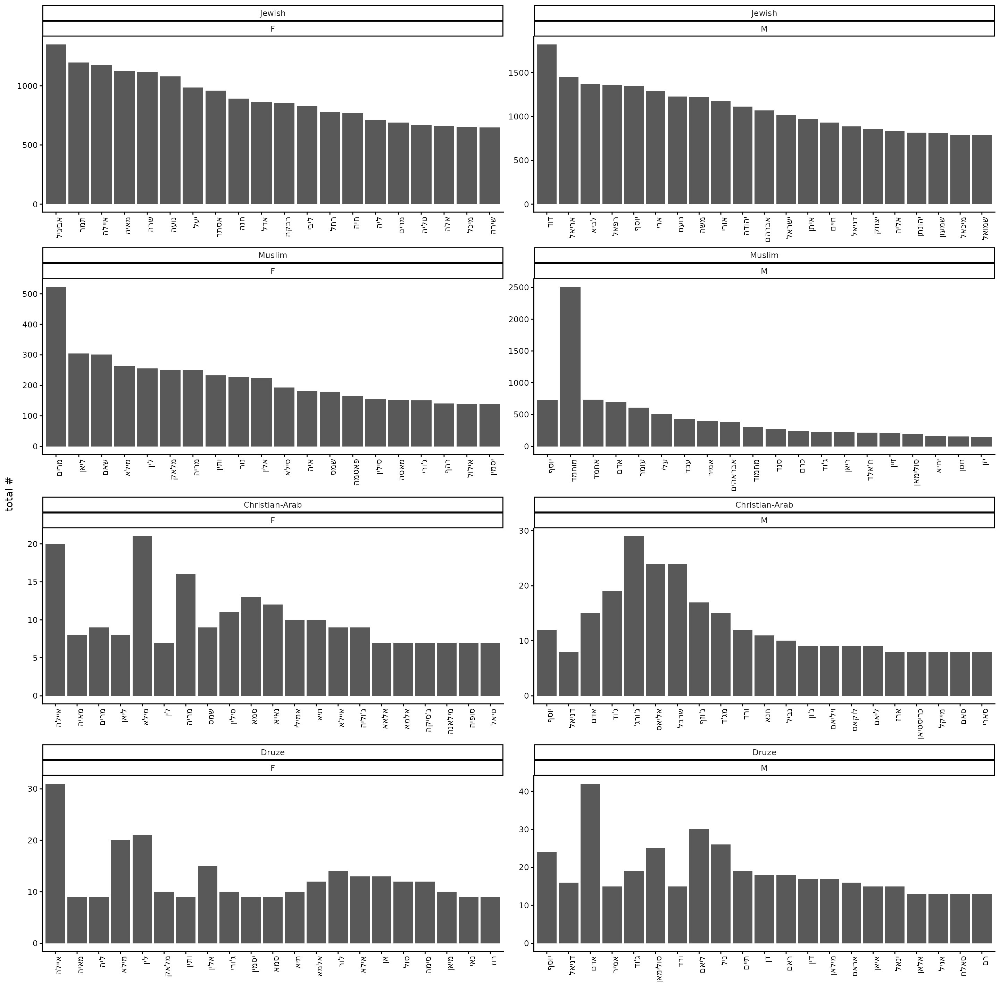
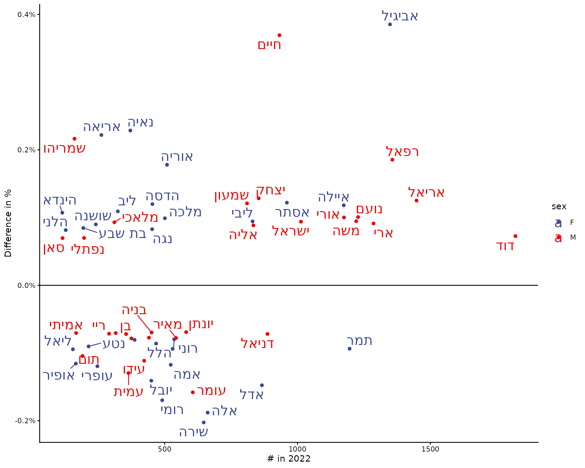
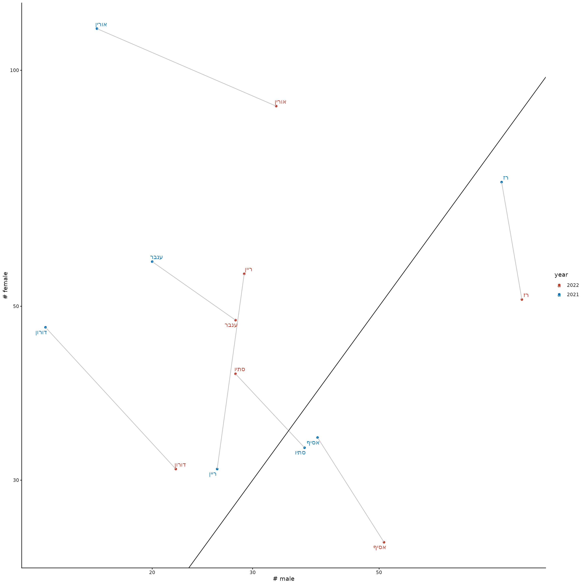
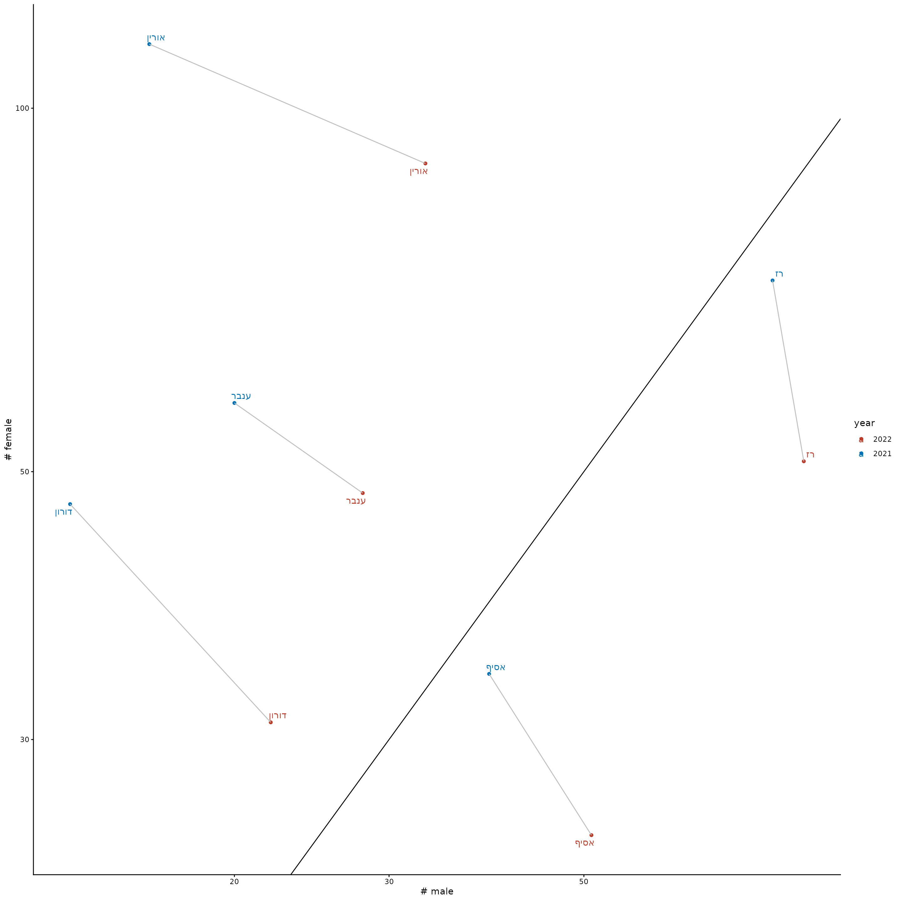
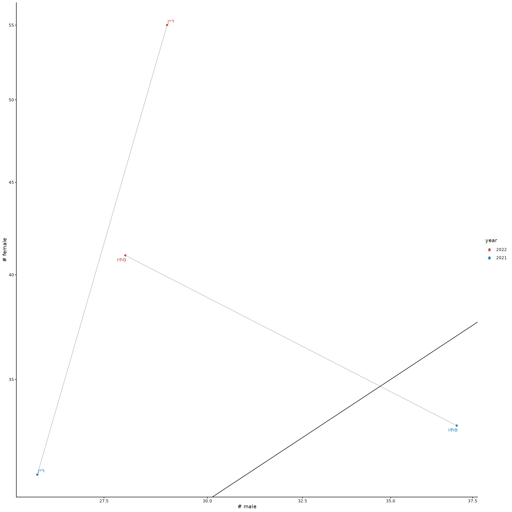

# 2022

``` r

library(babynamesIL)
library(tidyverse)
#> ── Attaching core tidyverse packages ──────────────────────── tidyverse 2.0.0 ──
#> ✔ dplyr     1.2.1     ✔ readr     2.2.0
#> ✔ forcats   1.0.1     ✔ stringr   1.6.0
#> ✔ ggplot2   4.0.4     ✔ tibble    3.3.1
#> ✔ lubridate 1.9.5     ✔ tidyr     1.3.2
#> ✔ purrr     1.2.2     
#> ── Conflicts ────────────────────────────────────────── tidyverse_conflicts() ──
#> ✖ dplyr::filter() masks stats::filter()
#> ✖ dplyr::lag()    masks stats::lag()
#> ℹ Use the conflicted package (<http://conflicted.r-lib.org/>) to force all conflicts to become errors
library(tgstat)
theme_set(theme_classic())
```

## 2022

### Top 20 names

``` r

babynamesIL %>%
    filter(year == 2022) %>%
    mutate(sector = factor(sector, levels = c("Jewish", "Muslim", "Christian-Arab", "Druze"))) %>%
    group_by(sector, sex) %>%
    slice_max(order_by = n, n = 20) %>%
    arrange(sector, sex, desc(n)) %>%
    mutate(name = forcats::fct_inorder(name)) %>%
    ggplot(aes(x = name, y = n)) +
    geom_col() +
    facet_wrap(sector ~ sex, scales = "free", ncol = 2) +
    ylab("total #") +
    xlab("") +
    theme(axis.text.x = element_text(angle = 90, hjust = 1))
```



### Names that changed the most in popularity

``` r

babynamesIL %>%
    filter(year %in% c(2022, 2021), sector == "Jewish") %>%
    pivot_wider(names_from = year, values_from = c(prop, n)) %>%
    filter(!is.na(prop_2022) & !is.na(prop_2021)) %>%
    mutate(prop_diff = prop_2022 - prop_2021) %>%
    arrange(sex, desc(abs(prop_diff))) %>%
    group_by(sex) %>%
    slice(1:30) %>%
    ggplot(aes(x = n_2022, y = prop_diff, color = sex, label = name)) +
    geom_point() +
    theme_classic() +
    ggsci::scale_color_aaas() +
    ggrepel::geom_text_repel(size = 6) +
    scale_y_continuous(label = scales::percent) +
    geom_hline(yintercept = 0) +
    ylab("Difference in %") +
    xlab("# in 2022")
```



### Names that shifted from ‘male’ to ‘female’ and vice versa

Names given to both boys and girls in both 2021 and 2022, with at least
50 babies in each year, whose male share (the number of boys divided by
the number of boys and girls with that name) changed by at least 10
percentage points:

``` r

unisex_data <- babynamesIL %>%
    filter(sector == "Jewish", year %in% c(2021, 2022)) %>%
    pivot_wider(names_from = "sex", values_from = c("n", "prop"), values_fill = 0) %>%
    filter(n_M > 0 & n_F > 0) %>%
    mutate(male_share = n_M / (n_M + n_F)) %>%
    group_by(name) %>%
    filter(n() == 2) %>%
    filter(all(n_M + n_F >= 50)) %>%
    mutate(change = male_share[year == 2022] - male_share[year == 2021]) %>%
    ungroup() %>%
    filter(abs(change) >= 0.1)
unisex_data %>%
    ggplot(aes(x = n_M, y = n_F, label = name, color = factor(year, levels = c(2022, 2021)), group = name)) +
    geom_point() +
    ggsci::scale_color_nejm(name = "year") +
    geom_line(color = "gray") +
    scale_x_log10() +
    scale_y_log10() +
    ggrepel::geom_text_repel() +
    geom_abline() +
    xlab("# male") +
    ylab("# female")
```



Only names that became more male:

``` r

unisex_data %>%
    filter(change > 0) %>%
    ggplot(aes(x = n_M, y = n_F, label = name, color = factor(year, levels = c(2022, 2021)), group = name)) +
    geom_point() +
    ggsci::scale_color_nejm(name = "year") +
    geom_line(color = "gray") +
    scale_x_log10() +
    scale_y_log10() +
    ggrepel::geom_text_repel() +
    geom_abline() +
    xlab("# male") +
    ylab("# female")
```



Only names that became more female:

``` r

unisex_data %>%
    filter(change < 0) %>%
    ggplot(aes(x = n_M, y = n_F, label = name, color = factor(year, levels = c(2022, 2021)), group = name)) +
    geom_point() +
    ggsci::scale_color_nejm(name = "year") +
    geom_line(color = "gray") +
    scale_x_log10() +
    scale_y_log10() +
    ggrepel::geom_text_repel() +
    geom_abline() +
    xlab("# male") +
    ylab("# female")
```


