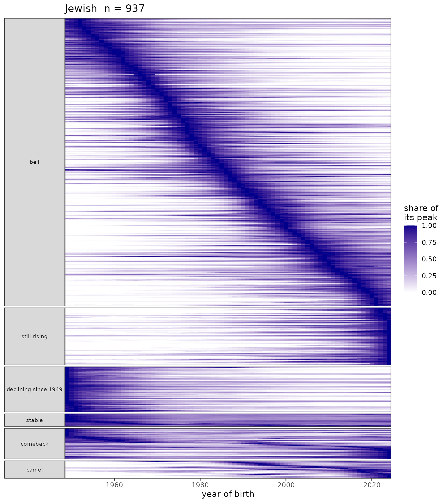
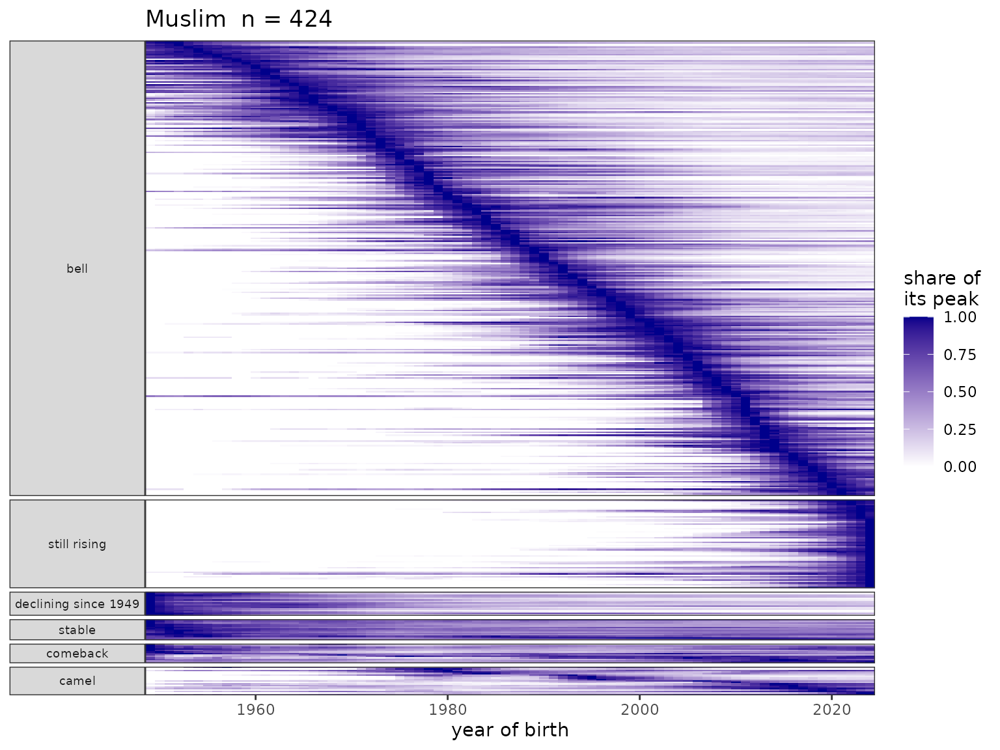
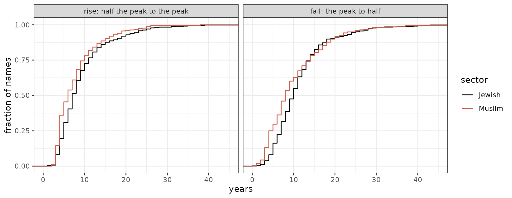
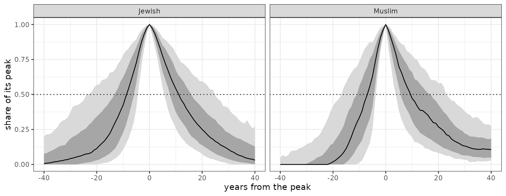
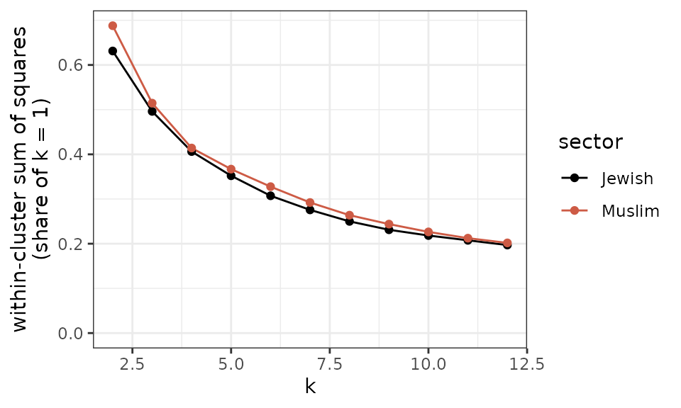
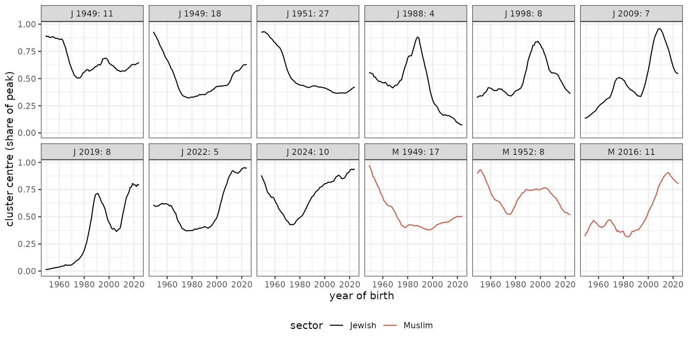
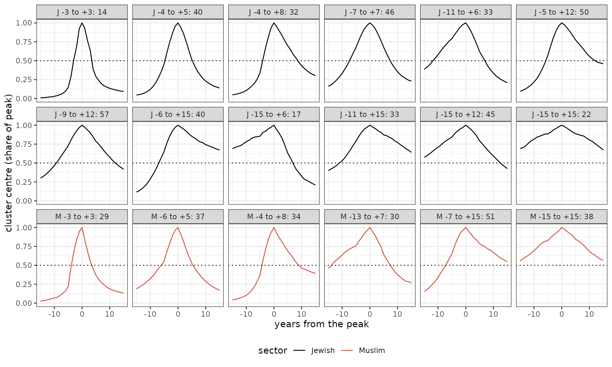

# How names rise and fall

``` r

library(babynamesIL)
library(tidyverse)
theme_set(theme_bw())
```

Most names rise to one peak and fall again. This article measures how
long that takes, sorts every name into one of six shapes, and checks
with k-means clustering whether the shapes miss any behavior. The web
app shows the same shapes and numbers on its [Rise and fall
page](https://babynames.lifshitz.xyz/?page=rise), and the shape of each
name on its name page; the code here and the app’s (`web/lib.js`) follow
the same rules and are checked against the same numbers.

A note on the data: CBS counts Israeli residents in the population
register (as of April 2025) by year of birth, under their current first
name. The early years therefore also include people who immigrated later
and people who changed their name. “Babies” below is short for that.

## The curve of a name

For each name and sex in a sector, the curve is the name’s share of the
listed babies of that sector and sex each year, averaged over 5 years
(centered; the first and last years are repeated at the ends), and
divided by its own maximum, so every curve peaks at 1. Only names given
to 50 or more babies in their top year are used. “Half its peak” is 0.5
on this curve.

``` r

years <- min(babynamesIL$year):max(babynamesIL$year)
min_top <- 50
edge <- 3 # a peak in the first or last 3 years is not taken as an inner peak

smooth5 <- function(v) {
    n <- length(v)
    idx <- pmin(pmax(outer(seq_len(n), -2:2, `+`), 1), n)
    rowMeans(matrix(v[idx], n))
}

shares <- babynamesIL %>%
    group_by(sector, sex, year) %>%
    mutate(share = n / sum(n)) %>%
    ungroup() %>%
    select(sector, sex, name, year, n, share) %>%
    complete(nesting(sector, sex, name), year = years, fill = list(n = 0, share = 0))

curves <- shares %>%
    group_by(sector, sex, name) %>%
    filter(max(n) >= min_top) %>%
    arrange(year, .by_group = TRUE) %>%
    summarise(top = max(n), x = list(smooth5(share) / max(smooth5(share))), .groups = "drop")
count(curves, sector)
#> # A tibble: 4 × 2
#>   sector             n
#>   <chr>          <int>
#> 1 Christian-Arab     6
#> 2 Druze              8
#> 3 Jewish           937
#> 4 Muslim           424
```

## Six shapes

Each name gets one shape, by these rules, in this order:

1.  **Comeback** or **camel** (two waves): the curve has a dip (away
    from the first and last 5 years) below half of the lower of the
    highs on its two sides, and that lower high is at least a quarter of
    the peak. It is a comeback if the first year is already at half the
    first high (the name did not rise into it within the data),
    otherwise a camel. When a curve has several dips, the deepest one
    (relative to its lower high) counts.
2.  **Stable**: never below a third of its peak.
3.  **Still rising**: peak in the last 3 years.
4.  **Declining since 1949**: peak in the first 3 years.
5.  **Bell**: the rest, one peak inside the years.

The span of a name is measured on the same curve. **Rise**: years from
the first year at half the peak to the peak. **Fall**: years from the
peak to the last year at half the peak. Each is measured only when the
peak is at least 3 years inside the data and that side crosses half
inside it, so names cut by the first or last year do not pull the
numbers down.

``` r

shape_levels <- c("bell", "still rising", "declining since 1949", "stable", "comeback", "camel")

deepest_dip <- function(x) {
    n <- length(x)
    pre <- cummax(x)
    post <- rev(cummax(rev(x)))
    m <- 6:(n - 5)
    lo <- pmin(pre[m - 1], post[m + 1])
    ok <- lo >= 1 / 4
    if (!any(ok)) {
        return(NULL)
    }
    r <- ifelse(ok, x[m] / pmax(lo, 1e-12), Inf)
    low <- m[which.min(r)]
    list(depth = min(r), low = low, high1 = which.max(x[1:(low - 1)]), high2 = low + which.max(x[(low + 1):n]))
}

shape_of <- function(x) {
    n <- length(x)
    p <- which.max(x)
    d <- deepest_dip(x)
    if (!is.null(d) && d$depth < 1 / 2) {
        return(if (x[1] >= x[d$high1] / 2) "comeback" else "camel")
    }
    if (min(x) >= 1 / 3) {
        return("stable")
    }
    if (p > n - edge) {
        return("still rising")
    }
    if (p <= edge) {
        return("declining since 1949")
    }
    "bell"
}

spans_of <- function(x) {
    n <- length(x)
    p <- which.max(x)
    l <- p
    r <- p
    while (l > 1 && x[l - 1] >= 0.5) l <- l - 1
    while (r < n && x[r + 1] >= 0.5) r <- r + 1
    inner <- p > edge && p <= n - edge
    tibble(
        peak = years[p], from = years[l], to = years[r],
        rise = if (inner && l > 1) p - l else NA_integer_,
        fall = if (inner && r < n) r - p else NA_integer_
    )
}

dyn <- curves %>%
    mutate(shape = factor(map_chr(x, shape_of), levels = shape_levels), sp = map(x, spans_of)) %>%
    unnest(sp)

dyn %>%
    count(sector, shape) %>%
    pivot_wider(names_from = sector, values_from = n, values_fill = 0) %>%
    knitr::kable()
```

| shape                | Christian-Arab | Druze | Jewish | Muslim |
|:---------------------|---------------:|------:|-------:|-------:|
| bell                 |              5 |     7 |    596 |    303 |
| stable               |              1 |     0 |     27 |     14 |
| still rising         |              0 |     1 |    119 |     59 |
| declining since 1949 |              0 |     0 |     94 |     16 |
| comeback             |              0 |     0 |     64 |     13 |
| camel                |              0 |     0 |     37 |     19 |

Every name as one row, grouped by shape and ordered by peak year. The
diagonal in “bell” is the procession of fashions: each name has its
turn, and most turns are short.

``` r

heat_plot <- function(s) {
    dyn %>%
        filter(sector == s) %>%
        arrange(shape, peak, name) %>%
        group_by(shape) %>%
        mutate(row = row_number()) %>%
        ungroup() %>%
        mutate(year = list(years)) %>%
        select(shape, row, x, year) %>%
        unnest(c(x, year)) %>%
        ggplot(aes(year, row, fill = x)) +
        geom_raster() +
        scale_fill_gradient(low = "white", high = "darkblue", limits = c(0, 1), name = "share of\nits peak") +
        scale_y_reverse(expand = c(0, 0)) +
        scale_x_continuous(expand = c(0, 0)) +
        facet_grid(shape ~ ., scales = "free_y", space = "free_y", switch = "y") +
        labs(x = "year of birth", y = NULL, title = sprintf("%s  n = %d", s, sum(dyn$sector == s))) +
        theme(
            axis.text.y = element_blank(), axis.ticks.y = element_blank(),
            strip.text.y.left = element_text(angle = 0, size = 7, margin = margin(0, 3, 0, 3)), panel.spacing.y = unit(2, "pt")
        )
}
```

``` r

heat_plot("Jewish")
```



``` r

heat_plot("Muslim")
```



The biggest names of the four less common shapes:

``` r

dyn %>%
    filter(sector %in% c("Jewish", "Muslim"), shape %in% c("stable", "comeback", "camel", "still rising")) %>%
    group_by(sector, shape) %>%
    slice_max(top, n = 10, with_ties = FALSE) %>%
    summarise(names = paste(name, collapse = ", "), .groups = "drop") %>%
    knitr::kable()
```

| sector | shape | names |
|:---|:---|:---|
| Jewish | still rising | לביא, אריאל, אביגיל, ארי, אליה, ליבי, אימרי, עלמה, אריאל, אורי |
| Jewish | stable | דוד, יוסף, משה, אברהם, מרים, אהרון, חיים, חנה, שמואל, רבקה |
| Jewish | comeback | רפאל, יהודה, ישראל, חיה, אלה, רות, בן, נעמי, יהודית, מלכה |
| Jewish | camel | איתן, מאיה, איילה, הילה, אדם, דור, תום, בת, רואי, גלי |
| Muslim | still rising | אדם, ותין, סנד, מסק, מילא, זיין, מריה, ימאן, סילא, ריאן |
| Muslim | stable | מוחמד, אחמד, יוסף, עלי, אבראהים, מוסטפא, סולימאן, מוסא, קאסם, אמין |
| Muslim | comeback | עומר, מרים, עבדאללה, סארה, יחיא, זינב, פארס, חדיגה, ג’יהאד, רחמה |
| Muslim | camel | באסל, שרה, ג’אד, עמאר, ראניה, למיס, סלמא, מוראד, יאסין, סלאם |

Some of these sit on the edge of a rule. A name with a low but sizable
level in 1949 and one big rise later can count as a comeback (בן,
ניקול), and a one-year spike can make a second high (שמחה, in the
1990s). In the Muslim sector the early years have few listed babies
(3203 in 1949), so some early dips there (ג’יהאד, פארס) may be noise,
and several Muslim camel curves are jagged.

## How long a rise and fall takes

``` r

med <- function(v) {
    v <- v[!is.na(v)]
    if (length(v) < 20) {
        return("too few names")
    }
    sprintf("%s (%s-%s), n=%d", format(median(v)), round(quantile(v, 0.25)), round(quantile(v, 0.75)), length(v))
}
dyn %>%
    group_by(sector) %>%
    summarise(
        span = med(if_else(!is.na(rise) & !is.na(fall), rise + fall + 1L, NA_integer_)),
        rise = med(rise), fall = med(fall)
    ) %>%
    relocate(span, .after = fall) %>%
    knitr::kable(caption = "Median years (middle half of the names), and the number of names measured. Span: years at or above half the peak, for names with both sides measured.")
```

| sector         | rise            | fall             | span              |
|:---------------|:----------------|:-----------------|:------------------|
| Christian-Arab | too few names   | too few names    | too few names     |
| Druze          | too few names   | too few names    | too few names     |
| Jewish         | 7 (5-11), n=534 | 10 (7-14), n=524 | 18 (14-25), n=399 |
| Muslim         | 6 (4-10), n=297 | 8 (5-14), n=276  | 15 (10-23), n=241 |

Median years (middle half of the names), and the number of names
measured. Span: years at or above half the peak, for names with both
sides measured. {.table}

A typical name takes about 7 years to climb from half its peak to the
peak, and 10 years to fall back to half (Jewish sector); Muslim names
are faster on both sides. The fall is slower than the rise for most
names, and names that rise slowly also tend to fall slowly:

``` r

both %>%
    filter(sector %in% c("Jewish", "Muslim")) %>%
    group_by(sector) %>%
    summarise(
        names = n(), fall_slower = mean(fall > rise), fall_faster = mean(fall < rise),
        spearman_rho = cor(rise, fall, method = "spearman")
    ) %>%
    knitr::kable(digits = 2)
```

| sector | names | fall_slower | fall_faster | spearman_rho |
|:-------|------:|------------:|------------:|-------------:|
| Jewish |   399 |        0.62 |        0.29 |         0.34 |
| Muslim |   241 |        0.57 |        0.30 |         0.48 |

``` r

dyn %>%
    filter(sector %in% c("Jewish", "Muslim")) %>%
    pivot_longer(c(rise, fall), names_to = "side", values_to = "years_") %>%
    filter(!is.na(years_)) %>%
    mutate(side = factor(side, c("rise", "fall"), c("rise: half the peak to the peak", "fall: the peak to half"))) %>%
    ggplot(aes(years_, color = sector)) +
    stat_ecdf(geom = "step") +
    scale_color_manual(values = c(Jewish = "black", Muslim = "coral3")) +
    facet_wrap(~side) +
    coord_cartesian(xlim = c(0, 45)) +
    labs(x = "years", y = "fraction of names")
```



Lining up the bell names on their peak year shows the typical shape. The
median curve is at or above half its peak from about 8 years before the
peak to 11 after (Jewish). It does not fall to zero: 20 years after the
peak the median name is still at about a quarter of its peak, which is
why the whole curve, tails included, spans about 40 years.

``` r

aligned <- dyn %>%
    filter(sector %in% c("Jewish", "Muslim"), shape == "bell") %>%
    mutate(p = peak - min(years) + 1) %>%
    select(sector, name, sex, p, x) %>%
    crossing(offset = -40:40) %>%
    mutate(i = p + offset) %>%
    filter(i >= 1, i <= length(years)) %>%
    mutate(v = map2_dbl(x, i, ~ .x[.y])) %>%
    group_by(sector, offset) %>%
    filter(n() >= 30) %>%
    summarise(
        q10 = quantile(v, 0.1), q25 = quantile(v, 0.25), q50 = median(v),
        q75 = quantile(v, 0.75), q90 = quantile(v, 0.9), .groups = "drop"
    )

ggplot(aligned, aes(offset)) +
    geom_ribbon(aes(ymin = q10, ymax = q90), fill = "gray85") +
    geom_ribbon(aes(ymin = q25, ymax = q75), fill = "gray65") +
    geom_line(aes(y = q50)) +
    geom_hline(yintercept = 0.5, linetype = "dotted") +
    facet_wrap(~sector) +
    labs(x = "years from the peak", y = "share of its peak")
```



Light band: middle 80% of the names; dark band: middle half; line:
median; dotted: half the peak. Only offsets with at least 30 names are
drawn.

### Does the cut-off of 50 babies matter?

Rerunning everything with other cut-offs for the name’s top year:

``` r

map_dfr(c(100, 50, 30, 20), function(th) {
    shares %>%
        group_by(sector, sex, name) %>%
        filter(max(n) >= th) %>%
        arrange(year, .by_group = TRUE) %>%
        summarise(x = list(smooth5(share) / max(smooth5(share))), .groups = "drop") %>%
        mutate(shape = factor(map_chr(x, shape_of), levels = shape_levels), sp = map(x, spans_of)) %>%
        unnest(sp) %>%
        group_by(sector) %>%
        summarise(
            top_year_at_least = th, names = n(),
            span = median((rise + fall + 1)[!is.na(rise) & !is.na(fall)]),
            rise = median(rise, na.rm = TRUE), fall = median(fall, na.rm = TRUE),
            shapes = paste(as.integer(table(shape)), collapse = " / ")
        )
}) %>%
    arrange(factor(sector, c("Jewish", "Muslim", "Christian-Arab", "Druze")), desc(top_year_at_least)) %>%
    knitr::kable(caption = paste("Shapes:", paste(shape_levels, collapse = " / ")))
```

| sector | top_year_at_least | names | span | rise | fall | shapes |
|:---|---:|---:|---:|---:|---:|:---|
| Jewish | 100 | 649 | 18.0 | 7.0 | 10.0 | 439 / 77 / 54 / 26 / 36 / 17 |
| Jewish | 50 | 937 | 18.0 | 7.0 | 10.0 | 596 / 119 / 94 / 27 / 64 / 37 |
| Jewish | 30 | 1188 | 17.0 | 7.0 | 9.0 | 735 / 152 / 132 / 27 / 82 / 60 |
| Jewish | 20 | 1470 | 17.0 | 7.0 | 9.0 | 864 / 172 / 186 / 27 / 118 / 103 |
| Muslim | 100 | 223 | 14.0 | 5.5 | 7.0 | 157 / 34 / 6 / 8 / 6 / 12 |
| Muslim | 50 | 424 | 15.0 | 6.0 | 8.0 | 303 / 59 / 16 / 14 / 13 / 19 |
| Muslim | 30 | 610 | 16.0 | 6.0 | 8.0 | 425 / 81 / 33 / 14 / 18 / 39 |
| Muslim | 20 | 825 | 15.0 | 6.0 | 8.0 | 545 / 106 / 57 / 14 / 23 / 80 |
| Christian-Arab | 50 | 6 | 8.0 | 3.0 | 4.0 | 5 / 0 / 0 / 1 / 0 / 0 |
| Christian-Arab | 30 | 29 | 11.0 | 5.0 | 5.0 | 25 / 0 / 1 / 2 / 0 / 1 |
| Christian-Arab | 20 | 76 | 14.0 | 5.0 | 6.0 | 55 / 2 / 6 / 2 / 4 / 7 |
| Druze | 50 | 8 | 7.5 | 4.0 | 3.5 | 7 / 1 / 0 / 0 / 0 / 0 |
| Druze | 30 | 42 | 12.0 | 4.0 | 4.0 | 33 / 4 / 1 / 0 / 0 / 4 |
| Druze | 20 | 113 | 13.0 | 5.0 | 6.0 | 91 / 9 / 3 / 0 / 0 / 10 |

Shapes: bell / still rising / declining since 1949 / stable / comeback /
camel {.table}

The spans hardly move. Christian-Arab and Druze names enter only at
lower cut-offs, where half of a name’s peak is close to the CBS floor of
5 babies a year, so their curves are noisy.

The 5-year average itself matters more: on the raw yearly share, the
same Jewish names give a median span of 14 years instead of 18, because
a single noisy year below half ends the span early, while the average
lowers and widens sharp peaks. Both are reasonable; the numbers above
use the average.

## Does clustering find other shapes?

The rules were written by looking at the curves, so they could miss a
behavior nobody looked for. k-means on the same curves (calendar years,
each scaled to its peak) checks that.

``` r

km <- function(X, k) {
    set.seed(1)
    kmeans(X, k, nstart = 20, iter.max = 100)
}
centre_peak <- function(fit) years[apply(fit$centers, 1, which.max)]

kmeans_table <- function(s, k) {
    d <- filter(dyn, sector == s)
    fit <- km(do.call(rbind, d$x), k)
    tibble(cluster = fit$cluster, shape = d$shape) %>%
        mutate(centre_peak = centre_peak(fit)[cluster]) %>%
        count(centre_peak, cluster, shape) %>%
        pivot_wider(names_from = shape, values_from = n, values_fill = 0) %>%
        arrange(centre_peak)
}
kmeans_table("Jewish", 5) %>% knitr::kable(caption = "Jewish, k = 5: clusters (by the peak year of their centre) by shape")
```

| centre_peak | cluster | bell | declining since 1949 | stable | comeback | camel | still rising |
|---:|---:|---:|---:|---:|---:|---:|---:|
| 1949 | 1 | 16 | 12 | 27 | 28 | 1 | 0 |
| 1949 | 5 | 123 | 82 | 0 | 18 | 1 | 0 |
| 1978 | 2 | 184 | 0 | 0 | 0 | 0 | 0 |
| 1999 | 3 | 181 | 0 | 0 | 6 | 16 | 7 |
| 2024 | 4 | 92 | 0 | 0 | 12 | 19 | 112 |

Jewish, k = 5: clusters (by the peak year of their centre) by shape
{.table}

With 5 clusters, k-means mostly cuts the names by the years they peaked,
not by shape: on calendar years the timing of the peak outweighs
everything else. The one cluster that follows shape is the traditional
names that were high all along: it holds all the stable names and many
of the comebacks. More clusters keep improving the fit, with no clear
elbow:

``` r

map_dfr(c("Jewish", "Muslim"), function(s) {
    X <- do.call(rbind, filter(dyn, sector == s)$x)
    tot <- sum(scale(X, scale = FALSE)^2)
    tibble(sector = s, k = 2:12, wss = map_dbl(2:12, ~ km(X, .x)$tot.withinss / tot))
}) %>%
    ggplot(aes(k, wss, color = sector)) +
    geom_line() +
    geom_point() +
    scale_color_manual(values = c(Jewish = "black", Muslim = "coral3")) +
    expand_limits(y = 0) +
    labs(y = "within-cluster sum of squares\n(share of k = 1)")
```



With many clusters (about 16 names each), most cluster centres are still
one rise and fall at different times. The centres that are not (more
than one stretch at or above half their maximum, or never below a third
of it) hold the shapes the rules name, plus one the rules leave in
“stable”, “bell” and “declining”: a decline to a lasting floor.

``` r

stretches <- function(v) {
    m <- v >= max(v) / 2
    m[1] + sum(!head(m, -1) & tail(m, -1))
}
many <- map_dfr(c("Jewish", "Muslim"), function(s) {
    d <- filter(dyn, sector == s)
    X <- do.call(rbind, d$x)
    fit <- km(X, round(nrow(X) / 16))
    odd <- which(apply(fit$centers, 1, function(v) stretches(v) > 1 || min(v) >= max(v) / 3))
    map_dfr(odd, function(j) {
        members <- d[fit$cluster == j, ]
        tibble(
            sector = s, cluster = j, centre_peak = years[which.max(fit$centers[j, ])], names = nrow(members),
            shapes = paste(names(sort(table(droplevels(members$shape)), decreasing = TRUE)), collapse = ", "),
            examples = paste(head(members$name[order(-members$top)], 6), collapse = ", "),
            centre = list(fit$centers[j, ])
        )
    })
})
many %>%
    select(-centre) %>%
    arrange(sector, centre_peak) %>%
    knitr::kable(caption = "Clusters whose centre is not one rise and fall, and the shapes of their names (most common first)")
```

| sector | cluster | centre_peak | names | shapes | examples |
|:---|---:|---:|---:|:---|:---|
| Jewish | 8 | 1949 | 11 | stable, comeback | אהרון, רבקה, בנימין, דבורה, פנחס, דן |
| Jewish | 59 | 1949 | 18 | comeback, declining since 1949, stable | שרה, חנה, שמואל, רות, לאה, מלכה |
| Jewish | 20 | 1951 | 27 | stable, bell, declining since 1949, comeback | דוד, יוסף, משה, אברהם, יעקב, רחל |
| Jewish | 53 | 1988 | 4 | bell, comeback | מריה, אלכסנדרה, שרי, חי |
| Jewish | 43 | 1998 | 8 | bell, comeback, stable | דניאל, יובל, רון, דניאלה, מישל, עטרה |
| Jewish | 12 | 2009 | 7 | bell, camel | אורי, מאיה, יאיר, יואב, גילי, גלי |
| Jewish | 58 | 2019 | 8 | camel, bell, still rising | עוז, תום, בת, דריה, לורן, דור |
| Jewish | 44 | 2022 | 5 | comeback, bell | תמר, יהודה, אלה, נעמי, אלישע |
| Jewish | 13 | 2024 | 10 | comeback, stable | ישראל, חיה, מנחם, נתן, נחמה, ברכה |
| Muslim | 9 | 1949 | 17 | stable, comeback, declining since 1949, bell | מרים, עבד, סולימאן, חסן, סאלח, זינב |
| Muslim | 10 | 1952 | 8 | stable, declining since 1949, comeback | מוחמד, אחמד, מחמוד, עלי, אבראהים, עבדאללה |
| Muslim | 12 | 2016 | 11 | camel, comeback, bell, stable | יוסף, עומר, סארה, שרה, יחיא, נדא |

Clusters whose centre is not one rise and fall, and the shapes of their
names (most common first) {.table}

``` r


many %>%
    arrange(sector, centre_peak) %>%
    mutate(panel = factor(sprintf("%s %d: %s", substr(sector, 1, 1), centre_peak, names), levels = unique(sprintf("%s %d: %s", substr(sector, 1, 1), centre_peak, names)))) %>%
    mutate(year = list(years)) %>%
    unnest(c(centre, year)) %>%
    ggplot(aes(year, centre, color = sector)) +
    geom_line() +
    scale_color_manual(values = c(Jewish = "black", Muslim = "coral3")) +
    facet_wrap(~panel, ncol = 6) +
    expand_limits(y = 0) +
    labs(y = "cluster centre (share of peak)", x = "year of birth") +
    theme(legend.position = "bottom")
```



Panel titles: sector, peak year of the centre, number of names.

### Clustering the shapes themselves

To ask k-means about shape alone, each curve is lined up on its peak
year and cut to 15 years on each side. Only names peaking in 1964-2009
have that whole window inside the data.

``` r

W <- 15
win <- dyn %>%
    filter(sector %in% c("Jewish", "Muslim")) %>%
    mutate(p = peak - min(years) + 1) %>%
    filter(p > W, p <= length(years) - W)
count(win, sector, shape) %>%
    pivot_wider(names_from = sector, values_from = n, values_fill = 0) %>%
    knitr::kable()
```

| shape    | Jewish | Muslim |
|:---------|-------:|-------:|
| bell     |    405 |    206 |
| stable   |      3 |      1 |
| comeback |      8 |      3 |
| camel    |     13 |      9 |

``` r


aligned_centres <- map_dfr(c(Jewish = 12, Muslim = 6) %>% imap(~ list(s = .y, k = .x)), function(a) {
    d <- filter(win, sector == a$s)
    X <- do.call(rbind, map2(d$x, d$p, ~ .x[(.y - W):(.y + W)]))
    fit <- km(X, a$k)
    half <- apply(fit$centers, 1, function(v) range(which(v >= max(v) / 2)) - W - 1)
    tibble(
        sector = a$s, cluster = seq_len(a$k), names = as.integer(table(factor(fit$cluster, seq_len(a$k)))),
        lo = half[1, ], hi = half[2, ], centre = map(seq_len(a$k), ~ unname(fit$centers[.x, ]))
    )
})
aligned_centres %>%
    arrange(sector, hi - lo) %>%
    mutate(panel = factor(sprintf("%s %+d to %+d: %d", substr(sector, 1, 1), lo, hi, names), levels = unique(sprintf("%s %+d to %+d: %d", substr(sector, 1, 1), lo, hi, names)))) %>%
    mutate(offset = list(-W:W)) %>%
    unnest(c(centre, offset)) %>%
    ggplot(aes(offset, centre, color = sector)) +
    geom_line() +
    geom_hline(yintercept = 0.5, linetype = "dotted") +
    scale_color_manual(values = c(Jewish = "black", Muslim = "coral3")) +
    facet_wrap(~panel, ncol = 6) +
    expand_limits(y = 0) +
    labs(x = "years from the peak", y = "cluster centre (share of peak)") +
    theme(legend.position = "bottom")
```



Panel titles: sector, the years from the peak where the centre is at or
above half its maximum, number of names; ordered from narrow to wide.
Every centre is a single rise and fall. They differ in width, from a few
years on each side to more than the whole window, and in which side is
slower: most fall more slowly than they rise, a few rise slowly and drop
fast. The widths form a continuum rather than separate groups, so the
six shapes, with the rise and fall times, describe the names well:
almost every name is one rise and fall of some width, and a minority
come back.
